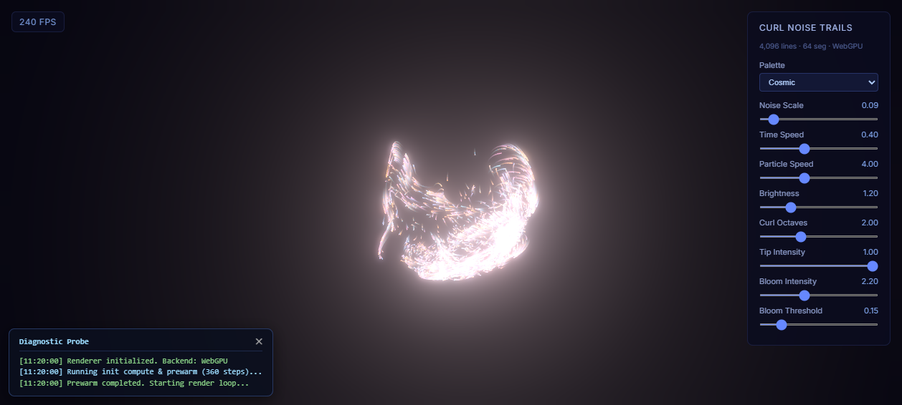

# WEBGPU Particles Ball (Curl Noise Trails)

基于 **Three.js (r183) WebGPU** 与 **TSL (Three.js Shading Language)** 构建的实时三维旋度场流光粒子球体模拟。

本项目复现并深度优化自 [OMMA Community - WebGPU Curl lines](https://omma.build/community/x7jvel6abc04)（原作者：Guillaume Gouessan）。



---

## 🌟 核心技术亮点

1. **纯 GPU 并行计算管线 (WebGPU Compute Shaders)**
   - 全程在 GPU 端进行动力学解算，CPU 开销几乎为 0，实测在现代 GPU 上轻松跑满 **240 FPS**。
   - **数据规模**：4,096 条独立粒子轨迹 × 64 个采样节点 = **262,144 个动态计算顶点**。
   - **计算着色器节点**：
     - `initCompute` / `initTrails`：基于立方根反余弦空间变换，实现粒子在三维球体内的均匀离散分布与生命周期初始化。
     - `shiftTrails`：在 GPU Storage Buffer 中按逆序进行内存平移，高效更新粒子轨迹的历史坐标点。
     - `updateParticles`：通过三维连续平滑值噪声（Smooth 3D Value Noise）与五次（Quintic）平滑插值，利用有限差分法实时求解 **旋度场 (Curl Noise)**，驱动粒子流动，并结合柔性球体边界回弹与重生机制。
     - `writeToGeometry`：将 GPU Storage Buffer 中的物理坐标与透明度衰减系数直接映射写入渲染几何体 `BufferGeometry`。

2. **TSL 节点材质与多主题配色系统**
   - 采用 Three.js 最新着色语言 **TSL (`three/tsl`)** 编写着色逻辑。
   - 内置 **6 大预置调色板**：`Cosmic`（宇宙）、`Ocean`（海洋）、`Fire`（火焰）、`Neon`（霓虹）、`Aurora`（极光）、`Ember`（余烬）。
   - 结合顶点 Hash 算法，为每条线条分配 5 种微调子方案，呈现丰富的明暗层次与冷暖色相递进。
   - 粒子头部高亮增强（Tip Intensity）与尾部渐隐衰减（Alpha Fade）。

3. **高动态范围 Bloom 辉光后期处理**
   - 搭载 `three/addons/tsl/display/BloomNode.js` 硬件级辉光滤镜。
   - 修复了原工程中对线条材质（`LineBasicNodeMaterial`）调用 MRT（多渲染目标）通道导致黑屏的兼容性问题，直接从高亮度像素中提取发射辉光，视觉体验极其纯净震撼。

4. **交互式控制面板与实时监测**
   - **HUD 控制面板**：可实时调节 Palette（配色方案）、Noise Scale（噪声尺度）、Time Speed（时间流速）、Particle Speed（粒子速率）、Brightness（整体亮度）、Curl Octaves（旋度倍频）、Tip Intensity（头部辉光）、Bloom Intensity（辉光强度）、Bloom Threshold（辉光阈值）。
   - **FPS 实时检测仪**：高精度监测当前设备渲染帧率。
   - **全自由视角**：集成 `OrbitControls`，支持鼠标拖拽旋转、滚轮缩放与右键平移。

---

## 🚀 快速启动

> 💡 **运行环境要求**：请使用支持 **WebGPU** 的现代浏览器（如 **Google Chrome 113+** 或 **Microsoft Edge 113+**），并确保在浏览器设置中开启了「使用图形加速（硬件加速）」。

### 方式一：使用 Vite 极速开发服务（推荐）

```bash
# 1. 克隆仓库
git clone https://github.com/pyw110001/WEBGPU_ParticlesBall.git
cd WEBGPU_ParticlesBall

# 2. 安装依赖
npm install

# 3. 启动开发服务器
npm run dev
```
启动后在浏览器打开：`http://localhost:5173/`

---

### 方式二：使用 Python 免安装启动

```bash
python -m http.server 8000
```
启动后在浏览器打开：`http://localhost:8000/`

---

### 方式三：使用 npx serve

```bash
npx serve .
```

---

## 📁 目录结构

```text
WEBGPU_ParticlesBall/
├── index.html          # 入口 HTML，配置 Import Map 引用 Three.js WebGPU / TSL
├── scene.js            # WebGPU 核心管线、TSL 计算着色器、材质节点与交互 UI
├── preview.png         # 项目运行效果预览截图
├── package.json        # NPM 项目配置与 Vite 脚本
├── package-lock.json   # 依赖锁定文件
├── project_data.json   # OMMA 原始元数据备份
├── .gitignore          # Git 忽略配置
└── README.md           # 项目详细说明文档
```

---

## 📄 License & Credits

* 灵感与原始原型归属于 [OMMA](https://omma.build/) 社区作者 **Guillaume Gouessan**。
* 代码遵循 MIT 协议开源。
